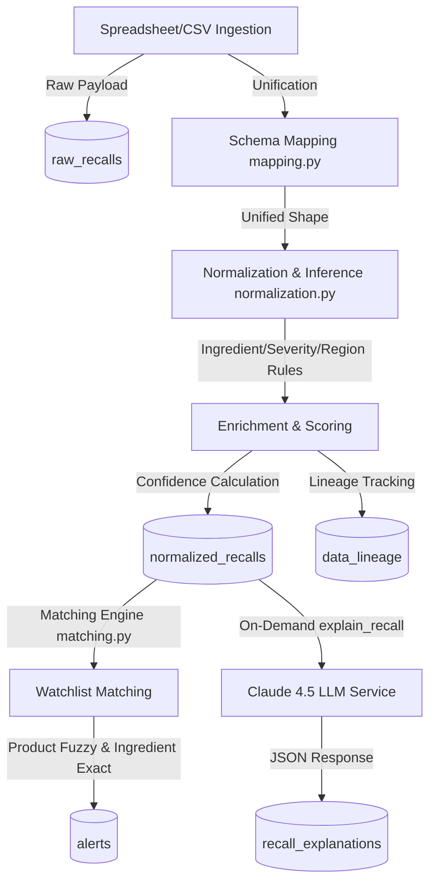

# Global Recall & Compliance Alert Platform

An enterprise-grade regulatory intelligence system designed to ingest, process, and normalize fragmented and inconsistent global recall datasets (e.g., EU Safety Gate, US FDA, Health Canada, and third-party country logs). The system converts raw spreadsheets into structured, normalized safety alerts, calculates metadata confidence scores, logs full data lineages, and matches occurrences against user watchlists to generate real-time alerts. It integrates Claude Sonnet 4.5 to provide plain-English, consumer-friendly summaries.

---

## 🏗️ System Architecture

The platform processes records using a multi-phase pipeline:



---

## 🛠️ Key Features

1. **Schema Mapping & Unification**: Maps 30+ column aliases from various international regulatory templates (US FDA, Health Canada, EU Safety Gate, etc.) to a unified database shape.
2. **Deterministic & Rule-Based Inference**: Automatically resolves missing regions, categorizes recalls (drug, cosmetic, device, food), infers severity (low, medium, high), and extracts ingredients.
3. **Data Lineage & Confidence Metrics**: Computes confidence scores using the ratio of inferred vs. explicitly provided fields. Every change or inference is recorded with its original value, inferred value, and method in a data lineage audit trail.
4. **Fuzzy & Exact Matcher**: Uses `rapidfuzz` (threshold $\ge 80$) to match watchlisted product names and exact/substring comparisons to match ingredients, generating real-time user-scoped alerts.
5. **AI Summaries**: Generates concise, structured, consumer-friendly explanations using Claude Sonnet 4.5 (with built-in database caching).
6. **Bloomberg-style UI Dashboard**: Provides a dense data-visualization dashboard featuring interactive metric grids, charts, full filterable feeds, a lineage inspector, autocomplete search, and watchlist management.

---

## 📁 Codebase Walkthrough

### 1. Backend Core ([backend/](file:///c:/Users/Lenovo/Desktop/Med-Alert-101-main/backend))

- [server.py](file:///c:/Users/Lenovo/Desktop/Med-Alert-101-main/backend/server.py): FastAPIs entry point. Registers routers, CORS middleware, initializes database indexes, seeds reference databases, starts the in-process queue worker, and triggers bootstrap folder ingestion.
- [db.py](file:///c:/Users/Lenovo/Desktop/Med-Alert-101-main/backend/db.py): Creates the MongoDB client via `motor`, loads the database instance, and builds all essential indexes (unique, text, compound).
- [pipeline.py](file:///c:/Users/Lenovo/Desktop/Med-Alert-101-main/backend/pipeline.py): Orchestrates the end-to-end processing pipeline, linking ingestion, mapping, normalization, lineage logging, and matching.
- [ingestion.py](file:///c:/Users/Lenovo/Desktop/Med-Alert-101-main/backend/ingestion.py): Parses CSV and Excel files robustly. Incorporates automatic header row detection to skip spreadsheet banners.
- [mapping.py](file:///c:/Users/Lenovo/Desktop/Med-Alert-101-main/backend/mapping.py): Maps global agency schemas to canonical field keys using column aliases.
- [normalization.py](file:///c:/Users/Lenovo/Desktop/Med-Alert-101-main/backend/normalization.py): Contains inference logic (keywords for severity, source file origins for regions, descriptions for category) and ingredient extraction.
- [matching.py](file:///c:/Users/Lenovo/Desktop/Med-Alert-101-main/backend/matching.py): Matches incoming recalls against all user watchlists and runs backfills when a watchlist is updated.
- [llm_service.py](file:///c:/Users/Lenovo/Desktop/Med-Alert-101-main/backend/llm_service.py): Generates structured explanations using Claude Sonnet 4.5.
- [queue_worker.py](file:///c:/Users/Lenovo/Desktop/Med-Alert-101-main/backend/queue_worker.py): In-process task queue that logs job documents (`queued`, `running`, `completed`, `failed`) to MongoDB.
- [seed_data.py](file:///c:/Users/Lenovo/Desktop/Med-Alert-101-main/backend/seed_data.py): Seeds database with 48 ingredient definitions, 17 product mappings, and 15 regional banned substances (EU, US).

#### API Routers ([backend/routers/](file:///c:/Users/Lenovo/Desktop/Med-Alert-101-main/backend/routers))
- [auth.py](file:///c:/Users/Lenovo/Desktop/Med-Alert-101-main/backend/auth.py): Implements session-based user authentication using the Google Social Login flow.
- [watchlist.py](file:///c:/Users/Lenovo/Desktop/Med-Alert-101-main/backend/routers/watchlist.py): Manages product and ingredient watchlist items, returns autocomplete suggestions.
- [alerts.py](file:///c:/Users/Lenovo/Desktop/Med-Alert-101-main/backend/routers/alerts.py): Returns and filters compliance alerts for the authenticated user.
- [recalls.py](file:///c:/Users/Lenovo/Desktop/Med-Alert-101-main/backend/routers/recalls.py): Retrieves global recalls with pagination, metadata searches, and AI explanation generation.
- [compliance.py](file:///c:/Users/Lenovo/Desktop/Med-Alert-101-main/backend/routers/compliance.py): Provides lists of banned substances and regulatory restrictions.
- [stats.py](file:///c:/Users/Lenovo/Desktop/Med-Alert-101-main/backend/routers/stats.py): Aggregates global metrics (severity breakdowns, region ratios, and data confidence buckets).
- [ingest.py](file:///c:/Users/Lenovo/Desktop/Med-Alert-101-main/backend/routers/ingest.py): Endpoint for uploading and processing local CSV or Excel files.
- [search.py](file:///c:/Users/Lenovo/Desktop/Med-Alert-101-main/backend/routers/search.py): Executes regex searches across recalls, ingredients, and banned substances.

---

### 2. Frontend Application ([frontend/](file:///c:/Users/Lenovo/Desktop/Med-Alert-101-main/frontend))

- [App.js](file:///c:/Users/Lenovo/Desktop/Med-Alert-101-main/frontend/src/App.js): Initializes router rules, intercepts OAuth credentials, and registers layout guards.
- [index.js](file:///c:/Users/Lenovo/Desktop/Med-Alert-101-main/frontend/src/index.js): Entry point for React rendering.
- [index.css](file:///c:/Users/Lenovo/Desktop/Med-Alert-101-main/frontend/src/index.css): Sets up custom font families (Chivo, IBM Plex) and modern color tokens.
- [AuthContext.jsx](file:///c:/Users/Lenovo/Desktop/Med-Alert-101-main/frontend/src/contexts/AuthContext.jsx): Stores session details and coordinates user profile synchronization.
- [api.js](file:///c:/Users/Lenovo/Desktop/Med-Alert-101-main/frontend/src/lib/api.js): Exposes the custom configured `axios` instance.

#### Page Components ([frontend/src/pages/](file:///c:/Users/Lenovo/Desktop/Med-Alert-101-main/frontend/src/pages))
- [Login.jsx](file:///c:/Users/Lenovo/Desktop/Med-Alert-101-main/frontend/src/pages/Login.jsx): Splitted editorial portal featuring statistics callouts.
- [Dashboard.jsx](file:///c:/Users/Lenovo/Desktop/Med-Alert-101-main/frontend/src/pages/Dashboard.jsx): Visual analytics including Recharts pie/bar graphs, recent alert tables, and database health meters.
- [Alerts.jsx](file:///c:/Users/Lenovo/Desktop/Med-Alert-101-main/frontend/src/pages/Alerts.jsx): User-specific alerts triggered by product or ingredient match.
- [Recalls.jsx](file:///c:/Users/Lenovo/Desktop/Med-Alert-101-main/frontend/src/pages/Recalls.jsx): Large tabular view of all ingested global recalls, complete with pagination, search, and region/severity filters.
- [RecallDetail.jsx](file:///c:/Users/Lenovo/Desktop/Med-Alert-101-main/frontend/src/pages/RecallDetail.jsx): Displays full metadata, AI-generated consumer summaries, and fields lineage tables.
- [Watchlist.jsx](file:///c:/Users/Lenovo/Desktop/Med-Alert-101-main/frontend/src/pages/Watchlist.jsx): Allows adding and removing products and ingredients, with autocomplete suggestions.
- [Compliance.jsx](file:///c:/Users/Lenovo/Desktop/Med-Alert-101-main/frontend/src/pages/Compliance.jsx): Explorable lookup catalog of regional banned substances.

---

## ⚙️ Setup and Installation

### Prerequisites

Ensure you have the following installed on your machine:
- **Python**: v3.10 or higher
- **Node.js**: v18 or higher (along with `npm` or `yarn`)
- **MongoDB**: An active local instance (or an accessible Atlas URI)

---

### Step 1: Database Initialization

1. Start your MongoDB server locally (default port: `27017`).
2. (Optional) **Seed a local test session/user** for bypass or API testing:
   Open a terminal and run `mongosh` (or use a GUI client) to execute the following snippet in your database (e.g., `med-alert`):
   ```javascript
   use med-alert

   // Seed user
   db.users.insertOne({
       "user_id": "test-user-harness",
       "email": "test@example.com",
       "name": "Test User",
       "picture": "https://images.unsplash.com/photo-1535713875002-d1d0cf377fde?auto=format&fit=crop&w=80&h=80&q=80",
       "created_at": new Date().toISOString(),
       "last_login": new Date().toISOString()
   })

   // Seed session token
   db.user_sessions.insertOne({
       "session_token": "test_session_harness",
       "user_id": "test-user-harness",
       "created_at": new Date().toISOString(),
       "expires_at": new Date(Date.now() + 10 * 365 * 24 * 60 * 60 * 1000).toISOString() // 10 years expiration
   })

   // Initialize watchlist
   db.watchlists.insertOne({
       "user_id": "test-user-harness",
       "products": ["TEST_Product_123"],
       "ingredients": ["mercury", "hydroquinone"],
       "updated_at": new Date().toISOString()
   })
   ```

---

### Step 2: Backend Setup

1. Open your terminal and navigate to the backend directory:
   ```bash
   cd backend
   ```
2. Create and activate a Python virtual environment:
   ```bash
   python -m venv venv
   # On Windows:
   venv\Scripts\activate
   # On macOS/Linux:
   source venv/bin/activate
   ```
3. Install the required dependencies:
   ```bash
   pip install -r requirements.txt
   ```
4. Create a `.env` configuration file inside the `backend/` directory:
   ```ini
   MONGO_URL=mongodb://localhost:27017
   DB_NAME=med-alert
   GOOGLE_CLIENT_ID=your_google_client_id.apps.googleusercontent.com
   CORS_ORIGINS=http://localhost:3000
   ```
   > [!NOTE]
   > On startup, the backend automatically creates MongoDB indexes, seeds master reference datasets, and automatically ingests the local spreadsheet datasets located in `../data`.

5. Boot the FastAPI application server:
   ```bash
   uvicorn server:app --host 127.0.0.1 --port 8000 --reload
   ```

---

### Step 3: Frontend Setup

1. Open a new terminal and navigate to the frontend directory:
   ```bash
   cd frontend
   ```
2. Install the node modules:
   ```bash
   npm install
   ```
3. Create a `.env` configuration file inside the `frontend/` directory:
   ```ini
   REACT_APP_BACKEND_URL=http://localhost:8000
   REACT_APP_GOOGLE_CLIENT_ID=your_google_client_id.apps.googleusercontent.com
   ```
4. Start the React development server:
   ```bash
   npm start
   # Or if using yarn:
   yarn start
   ```
   The browser should launch automatically. Access the app dashboard at `http://localhost:3000`.

---

## 🧪 Verification and Testing

### Running API Tests

Automated integration tests are located in [test_backend_api.py](file:///c:/Users/Lenovo/Desktop/Med-Alert-101-main/backend/tests/test_backend_api.py) and test all endpoints (health, authentication, recalls, alerts, watchlists, stats, search, ingest).

To execute the tests:
1. Ensure the backend server is running (with the database seeded).
2. Open a terminal in the backend directory.
3. Configure the backend URL environment variable and run `pytest`:
   ```bash
   # Windows PowerShell:
   $env:REACT_APP_BACKEND_URL="http://127.0.0.1:8000"
   pytest tests/test_backend_api.py -v --tb=short

   # macOS/Linux:
   export REACT_APP_BACKEND_URL="http://127.0.0.1:8000"
   pytest tests/test_backend_api.py -v --tb=short
   ```
