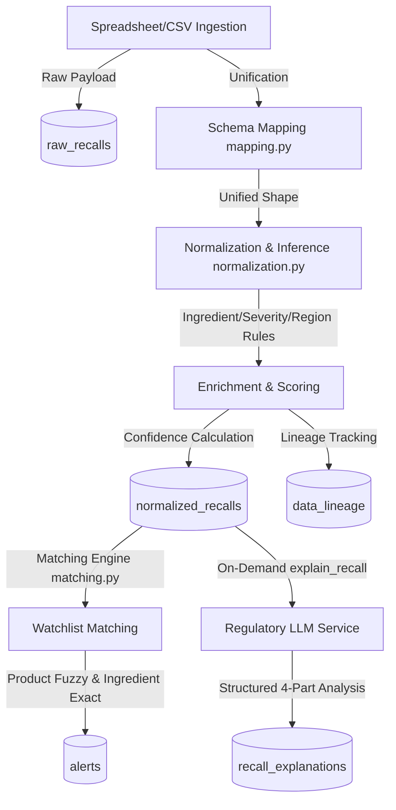

# Global Recall & Compliance Alert Platform (Med-Alert)

An enterprise-grade regulatory intelligence platform designed to ingest, normalize, and match fragmented and inconsistent global recall datasets (e.g., EU Safety Gate, US FDA, Health Canada, and third-party regulatory logs). The system unifies raw spreadsheets into structured, normalized safety alerts, calculates data completeness scores, maintains full field-level data lineages, and matches recalls against user watchlists to generate real-time alerts.

---

## 🏗️ System Architecture



---

## 🛠️ Key Capabilities

1. **Multi-Source Schema Mapping & Normalization**: Maps 30+ column aliases from diverse international templates to a unified schema with automatic banner skipping and header promotion.
2. **Deterministic Inference Engine**: Resolves missing regions, categorizes recalls (drug, cosmetic, device, food), infers risk severity (low, medium, high), and extracts ingredients.
3. **Data Completeness & Full Lineage Audit Trail**: Calculates source data completeness scores based on explicit vs. inferred attributes, maintaining an immutable field-level provenance log.
4. **High-Precision Matching Engine**: Uses tokenized exact matching and boundary-guarded `rapidfuzz` (threshold $\ge 80$) for watched products, and canonical synonym alias mapping for ingredients. Placeholder/inferred ingredients are clearly distinguished and not treated as verified evidence.
5. **AI Regulatory Explanations**: Generates evidence-backed structured summaries detailing *What Happened*, *Risk Level*, *Who is Affected*, and *What to Do* with automatic database caching.
6. **Local Development Without MongoDB**: The backend falls back to `mongomock-motor` when MongoDB is unavailable. Portal uploads are archived under `backend/manual_uploads/` and reloaded at startup so manually uploaded datasets survive a backend restart. Set `UPLOAD_ARCHIVE_DIR` to a persistent mounted directory when deploying without MongoDB.
7. **One-Click Demo Access**: Seeded test harness session enables instant one-click login without requiring Google OAuth credentials.

---

## 🚀 Quick Start (Under 2 Minutes)

### Prerequisites
- **Python**: v3.10 or higher (Python 3.10–3.14 supported)
- **Node.js**: v18 or higher (Node.js v20+ with `yarn` or `npm`)
- *(Optional)* **MongoDB**: Not required! The platform runs an in-memory MongoDB engine (`mongomock-motor`) by default.

---

### Step 1: Start the Backend Server

1. Open a terminal and navigate to the `backend/` directory:
   ```bash
   cd backend
   ```

2. (Recommended) Activate your Python virtual environment:
   ```bash
   # Windows PowerShell / CMD:
   python -m venv venv
   .\venv\Scripts\activate

   # macOS / Linux:
   python3 -m venv venv
   source venv/bin/activate
   ```

3. Install backend dependencies:
   ```bash
   pip install -r requirements.txt
   ```

4. Configure your environment file (`backend/.env`):
   ```ini
   MONGO_URL=mongodb://localhost:27017
   DB_NAME=med_alert
   USE_MOCK_MONGO=true
   CORS_ORIGINS=http://localhost:3000,http://127.0.0.1:3000,http://localhost:8000
   ```
   > [!NOTE]
   > Setting `USE_MOCK_MONGO=true` enables the in-memory MongoDB mock client. Portal uploads are saved under `backend/manual_uploads/` by default and reloaded after a restart. Set `UPLOAD_ARCHIVE_DIR` to a persistent mounted directory if your deployment uses temporary application storage. If you have an active MongoDB daemon running on port 27017, set `USE_MOCK_MONGO=false` to persist records directly in MongoDB.

5. Start the FastAPI server:
   ```bash
   # From the project root or backend folder:
   python -m uvicorn server:app --host 0.0.0.0 --port 8000
   ```
   *On startup, the server automatically builds database indexes, seeds reference ingredients and banned substances, and ingests 5,084 baseline records from the `data/` folder.*

   - **API Health Endpoint**: [http://localhost:8000/api/health](http://localhost:8000/api/health)
   - **Interactive Swagger Docs**: [http://localhost:8000/docs](http://localhost:8000/docs)

---

### Step 2: Start the Frontend Portal

1. Open a second terminal and navigate to the `frontend/` directory:
   ```bash
   cd frontend
   ```

2. Configure frontend environment variables (`frontend/.env`):
   ```ini
   REACT_APP_BACKEND_URL=http://localhost:8000
   BROWSER=none
   PORT=3000
   ```

3. Install frontend packages:
   ```bash
   # Using Yarn (recommended):
   yarn install

   # Or using npm:
   npm install
   ```

4. Start the React development server:
   ```bash
   # Using Yarn (Windows PowerShell):
   yarn.cmd start

   # Or using Yarn (macOS / Linux):
   yarn start

   # Or using npm:
   npm.cmd start
   ```

5. Open your browser and navigate to:
   👉 **[http://localhost:3000](http://localhost:3000)**

---

### Step 3: Logging In & Exploring the Demo

1. On the landing page (`http://localhost:3000/login`), click **"Quick Demo Access →"** (`data-testid="demo-login-btn"`).
2. You will be instantly logged in as the pre-authenticated **Demo User** with:
   - **Watchlist**: Configured with product `Skin Lightening` and ingredients `hydroquinone` and `mercury`.
   - **Alerts Feed**: Active high-severity alerts matching your watchlist.
   - **Recalls Explorer**: Search, filter by region (EU, US, etc.), and view field-level data lineages.
   - **AI Summary**: Click any recall to view its AI-generated regulatory explanation.
   - **Data Ingestion**: Navigate to the file upload section to upload custom CSV or Excel files.

---

## 🧪 Testing & Verification

### Running the Live Integration Test Suite

An automated runner is included in the project root to test all 26 backend endpoints against a live server instance:

```bash
# From the project root:
python run_api_integration.py
```

This runner boots the Uvicorn backend, polls the health endpoint until startup and data seeding are verified, executes `pytest backend/tests/test_backend_api.py -v`, and gracefully terminates the server.

### Running Pytest Directly

If your backend is already running on `http://127.0.0.1:8000`:

```bash
# Windows PowerShell:
$env:REACT_APP_BACKEND_URL="http://127.0.0.1:8000"
$env:PYTHONPATH="backend"
pytest backend/tests/test_backend_api.py -v --tb=short

# macOS / Linux:
export REACT_APP_BACKEND_URL="http://127.0.0.1:8000"
export PYTHONPATH="backend"
pytest backend/tests/test_backend_api.py -v --tb=short
```

---

## 📂 Controlled Demo Datasets

Controlled sample files are provided in `data/demo/` for demonstrating end-to-end ingestion and alert matching:

- `data/demo/valid_controlled_recall.csv`: Contains controlled recall matching `CardioGuard 500mg`, ingredient match on `GlowMax Bleaching Complex` (Hydroquinone), inferred ingredient recall `Tylenol Extra Strength`, and negative control `Orthopedic Knee Brace Model X`.
- `data/demo/valid_controlled_recall.xlsx`: Contains `DermaBright Night Cream` (Calomel -> Mercury) and negative control `Stainless Steel Surgical Scissors`.

You can upload either file through the portal UI or via `POST /api/ingest/upload` to observe real-time ingestion, lineage tracking, and alert triggers.

---

## 📁 Project Structure

```
Med-Alert-101-main/
├── backend/
│   ├── auth.py              # Social login, demo session, & token validation
│   ├── db.py                # Database connection with AsyncMongoMockClient fallback
│   ├── ingestion.py         # CSV/XLSX streaming parser & raw storage
│   ├── llm_service.py       # Evidence-backed regulatory explanations
│   ├── mapping.py           # Schema unification & alias mapping
│   ├── matching.py          # Watchlist matching engine (Rapidfuzz + canonical synonyms)
│   ├── normalization.py     # Deterministic inference & lineage generation
│   ├── pipeline.py          # Orchestration pipeline & startup bootstrap
│   ├── queue_worker.py      # Background ingestion task queue
│   ├── seed_data.py         # Ingredients master & banned substances
│   ├── server.py            # FastAPI application entry point
│   └── tests/
│       ├── test_backend_api.py       # 26-test comprehensive API integration suite
│       ├── test_ingest_reliability.py# File validation & temporary file isolation tests
│       └── test_matching_regression.py # Matching engine regression suite
├── data/
│   ├── demo/                # Controlled sample datasets for demo & regression
│   └── *.xlsx, *.csv        # Baseline historical recall datasets (5,000+ records)
├── frontend/
│   ├── public/              # Static assets (including landing page imagery)
│   ├── src/
│   │   ├── components/      # UI components (Layout, ProtectedRoute, MetricCard)
│   │   ├── contexts/        # AuthContext for session management
│   │   ├── pages/           # Dashboard, Recalls, Alerts, Watchlist, Compliance, Login
│   │   └── App.js           # Router configuration
│   ├── craco.config.js      # Build config with path alias resolution
│   └── package.json         # React 19 dependencies & scripts
├── run_api_integration.py   # Standalone live test runner
└── README.md                # Project documentation & instructions
```
